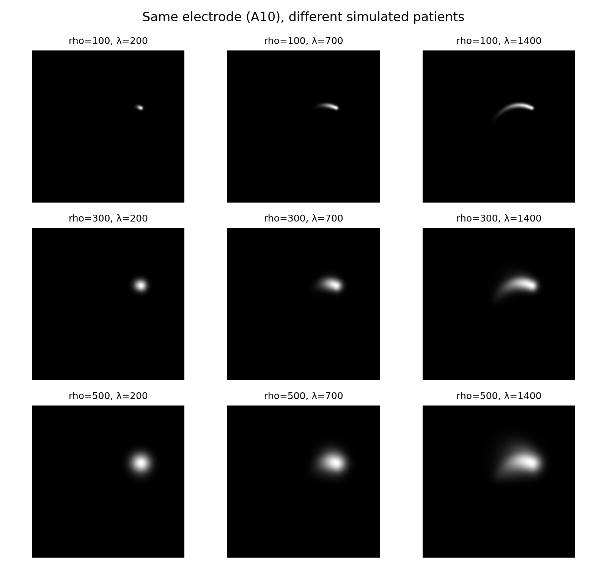
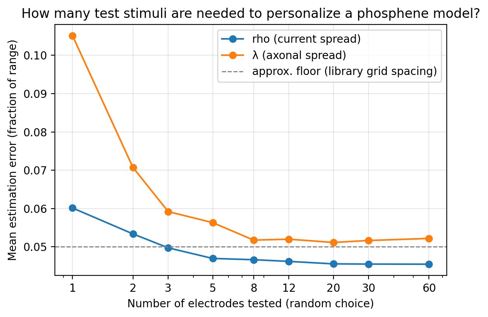
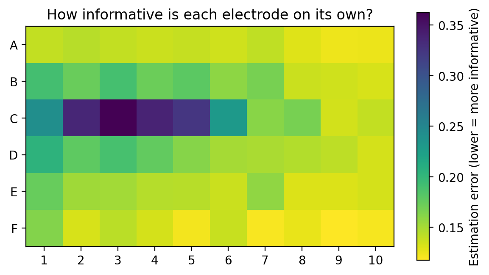

# How Many Test Stimuli Does It Take to Personalize a Phosphene Model?
### Efficient patient-specific fitting of the axon map model in simulation

In retinal prostheses, the same electrode produces differently shaped phosphenes in
different patients. In the axon map model (Beyeler et al., 2019), two patient-specific
parameters control this shape: **rho** (spread of current around the electrode) and
**λ** (spread along retinal nerve fiber bundles). Estimating them requires testing
patients, which is slow and tiring. This mini-project asks, in simulation: **how many
single-electrode tests are needed to estimate a patient's rho and λ, and which
electrodes are most worth testing?**

## Setup
- **Simulator:** pulse2percept 0.11, Argus II implant (60 electrodes), axon map model.
- **Simulated patients:** rho from 100 to 500 µm, λ from 200 to 1400 µm.
- **Features:** each single-electrode phosphene is summarized by its area and elongation
  (thresholded at 10% of peak brightness), standing in for a patient's drawing.
- **Fitting:** a library of 36 patients on a 6×6 (rho, λ) grid; 10 test patients with
  values between grid points; 10% multiplicative noise on features; parameters estimated
  by nearest match using k tested electrodes (50 random repeats per k).

## Results

**1. A few electrodes are enough.** With one randomly chosen electrode, mean error was
6.0% of the parameter range for rho and 10.5% for λ. By 3–5 electrodes both reached about
5%, the floor set by the library's grid spacing, and testing all 60 electrodes did not
improve further.

**2. λ is harder to estimate from very few tests.** With one electrode, λ error was
nearly double rho error, because whether an electrode reveals axonal streaks depends on
its location. Larger rho also partly masks streaks.

**3. Electrodes differ greatly in how informative they are.** Electrodes along the bottom
row and right edge of the array were most informative on their own, while a band in the
middle-left (C1–C6) was least informative, with up to about three times higher error.

**4. Choosing electrodes smartly helps most when tests are limited.** Ranking electrodes
on a separate set of 10 simulated patients and evaluating on the original test patients,
the single most informative electrode gave 23% lower error than a random one (0.131 vs.
0.170, combined rho + λ error) and the best two gave 11% lower error. By five electrodes,
smart and random choice performed about the same.

## Limitations
- Simulation only: the axon map model generates the data, so it is assumed to be correct.
- Two simple shape features; real patient drawings are noisier and more varied.
- Nearest-match fitting on a coarse grid sets an error floor of about 5% of the range.
- Small number of test patients (10), and a simple multiplicative noise model.
- The implant is at the default position and rotation; real Argus II placements vary,
  which would change which electrodes are most informative.

## Next steps
- Continuous parameter fitting instead of grid matching.
- Adaptive testing: choose each next electrode based on the responses so far.
- Vary implant placement and test with real patient drawing data.

## Reproducing
Open `phosphene_personalization.ipynb` in Google Colab (requires `pip install pulse2percept`, v0.11).

## References
- Beyeler, M., Nanduri, D., Weiland, J. D., Rokem, A., Boynton, G. M., & Fine, I. (2019).
  A model of ganglion axon pathways accounts for percepts elicited by retinal implants.
  *Scientific Reports*, 9, 9199.
- Beyeler, M., Boynton, G. M., Fine, I., & Rokem, A. (2017). pulse2percept: A Python-based
  simulation framework for bionic vision. *Proceedings of the 16th Python in Science
  Conference (SciPy)*, 81–88. doi:10.25080/shinma-7f4c6e7-00c
